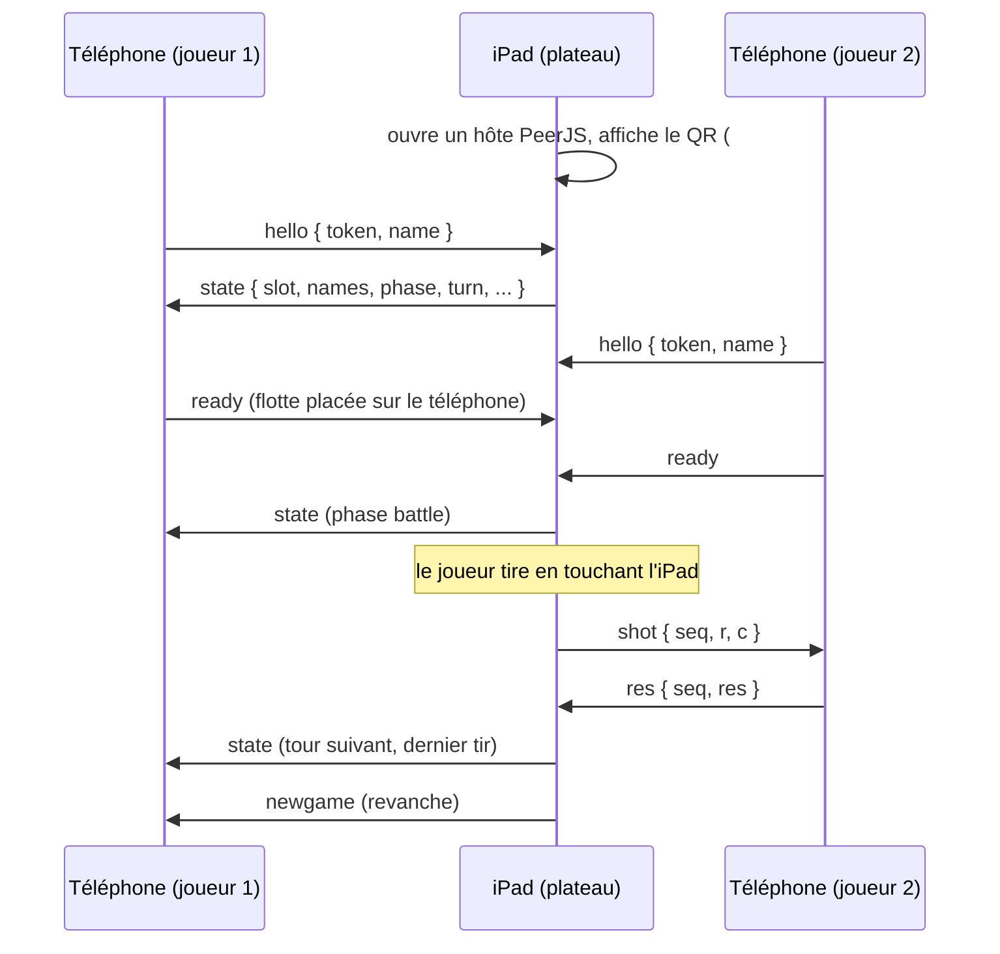

# Architecture

Application web statique, sans compilation ni serveur propre : HTML + JavaScript « classique » (pas de module, pas de framework), comme les autres jeux du même auteur (5 Rois, 6 qui prend, Flip 7, Le Contrat). Tout l'état est dans le navigateur (`localStorage`).

## Fichiers

```
index.html          Écrans (accueil, placement, bataille, face à face, plateau téléphone, téléphone), styles, modales
engine.js           Moteur pur : flotte, placement, tirs, ordinateur. Sans dépendance, testable sous Node
net.js              Liaison entre appareils (PeerJS) : Net.createHost (iPad), Net.joinHost (téléphone)
app.js              Interface : navigation, modes de jeu, sauvegarde, rendu des grilles, mode téléphone
sw.js               Service worker : cache hors ligne (réseau d'abord, cache en secours)
manifest.webmanifest, icons/    PWA
vendor/             peerjs.min.js, qrcode.js (bibliothèques tierces, voir THIRD_PARTY.md)
tests/engine.test.js            Tests du moteur (node --test)
tests/e2e/*.py                  Parcours navigateur (Playwright)
```

Ordre de chargement : `qrcode.js`, `peerjs.min.js`, `engine.js`, `net.js`, `app.js`.

## Moteur (`engine.js`)

Données JSON uniquement, donc sauvegardables telles quelles.

- **navire** : `{ id, name, len, cells: [[r, c], ...] }` (ids : `pa`, `cr`, `ct`, `sm`, `to`)
- **inc** : matrice 10 × 10 des tirs *reçus* par un joueur (0 rien, 1 à l'eau, 2 touché)
- **sunk** : navires coulés d'un joueur (donc révélés à tous)
- `fire(ships, inc, sunk, r, c)` renvoie `{ r, c, res: 'miss'|'hit'|'sunk', ship, allSunk }`
- `applyResult(inc, sunk, res)` rejoue un résultat côté « public », sans connaître la flotte (mode téléphone)
- `aiChoose(level, inc, sunk)` : l'ordinateur ne lit que `inc` et `sunk` de sa cible (il ne triche pas, et reprend la partie sans mémoire propre)
  - niveau 1 : au hasard, une chance sur deux de viser à côté d'un touché
  - niveau 2 : chasse en damier, puis prolonge la ligne des touchés
  - niveau 3 : densité de probabilité sur toutes les positions possibles des navires restants
  - ordre de force mesuré (300 parties) : environ 70, 51 et 45 tirs pour gagner

## État de partie (`G`, sauvegardé sous `bn_partie_v1`)

```
mode            'solo' | 'passe' | 'duo' | 'tel'
level, rejoue   niveau de l'ordinateur, variante « le joueur qui touche rejoue »
names           [nom0, nom1]
phase           'place' | 'battle' | 'over'
placing         joueur en train de placer (modes locaux)
turn            joueur qui tire
view, await     mode passe-passe : joueur affiché, tour terminé en attente du voile
veil            { kind: 'place'|'turn', who } : écran « passe l'appareil »
fleets          [flotte0, flotte1] (privé ; null en mode tel, les flottes restent sur les téléphones)
inc, sunk       tirs reçus et navires coulés par joueur (public)
last            dernier tir { by, r, c, res, name }
shots, winner   compteurs de tirs, vainqueur
ready, tokens, hostId   mode tel : flottes prêtes, jetons des téléphones, identifiant de l'iPad
```

## Écrans et rendu

`renderAll()` choisit l'écran d'après `G.mode` et `G.phase`, puis dessine le voile éventuel.

| Écran | Mode | Contenu |
|---|---|---|
| `#place` | solo, passe, duo, téléphone | Placement : touche la case de départ, pivote, au hasard, reprend un navire en le touchant |
| `#battle` | solo, passe | Eaux adverses (on vise) au-dessus, sa propre flotte en dessous |
| `#duo` | duo, tel | Deux sièges face à face (le siège du haut est tourné de 180°). Chaque grille = eaux d'un joueur, avec les tirs reçus |
| `#telhost` | tel (iPad) | QR code et état des deux téléphones |
| `#phone` | tel (téléphone) | Flotte secrète, impacts reçus, statut |

`gridHTML()` dessine toutes les grilles. Les navires ne sont affichés que si on les passe (`ships`) : jamais pour la grille d'un adversaire, sauf à la fin de partie dans les modes locaux.

Viser : un premier toucher sélectionne la case (réticule), un second sur la même case ou « Feu ! » tire.

## Mode téléphone

L'iPad ne connaît pas les flottes : il garde seulement `inc`, `sunk`, le tour et le dernier tir. Chaque téléphone garde sa flotte, calcule lui-même le résultat d'un tir et le renvoie.



- Le QR contient l'adresse de la page + `#j=<identifiant de l'iPad>` ; l'appareil photo du téléphone l'ouvre dans le navigateur, et la page passe en rôle « téléphone ».
- Un jeton aléatoire par téléphone (`bn_phone_v1`) permet de retrouver sa place après une coupure. Le téléphone retente la connexion toutes les 2,5 s ; l'iPad rouvre le même identifiant après rechargement.
- Une réponse manquante au bout de 8 s annule le tir sans changer le tour.
- Le service public de PeerJS ne sert qu'à mettre les appareils en relation ; les messages de jeu passent ensuite directement en WebRTC.
- Pour les tests, `window.BN_PEER_OPTIONS` remplace le serveur de mise en relation par un serveur local.

## Sauvegardes (localStorage)

| Clé | Contenu |
|---|---|
| `bn_partie_v1` | état `G` (iPad ou appareil local) |
| `bn_prefs_v1` | mode, niveau, variante, noms |
| `bn_phone_v1` | côté téléphone : jeton, flotte, tirs reçus, historique |
